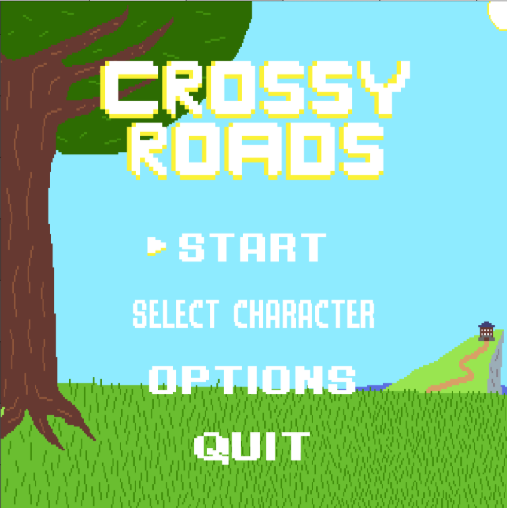
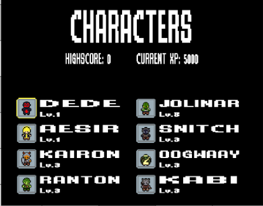

# Crossy Roads, Première Année, Télécom Nancy:

## Contenu :
- Ce dépot contient notre travail sur le Crossy Raod, à savoir un répertoire avec le code, et une partie gestion de projet.
- On trouve donc essentiellement des fichiers en .c assez explicites, et des fichiers pour l'affichage et la sauvegarde.

## Images :
Nous avons divers personnages avec différents pouvoirs :\

Et nous avons aussi différents biomes\

Ou encore un manoir en feu et une cave de cultistes\

Et enfin un biome extrême en terme de difficulté\

## Contributeurs :
- BALAJ Yovhann
- ROUQUETTE Arthur
- WARGNYE Louan
- GAIFFE Félix

## Consignes :
- Nous avons réalisé un jeu inspiré du jeu Crossy Road, donc un jeu en temps réel sous 
forme de cases avec des obstacles que le joueur doit éviter pour faire augmenter son score.
- Il était demandé de coder 2 versions, une version graphique avec SDL, et une dans le terminal.
- Nous avons décidé d'incorporer un système de biomes (5 biomes différents) 
ainsi que de nouveaux types d'obstacles allant de l'équivalent des voitures jusqu'au lanceur de projectiles 
et aux cultistes qui foncent sur le joueur.
- Nous avons également décidé d'ajouter des skins mais surtout des pouvoirs/capacités spéciales déblocables.
- Enfin, le projet comporte également une IA de minmax pour laquelle on peut régler la profondeur et le délai entre les mouvements.

## Pour jouer au jeu:
- appareils compatibles : Linux, Windows, Mac
- copier le dossier du git avant tout
- dépendances : pour SDL
    `sudo apt install libsdl2-*`
              : pour la version terminal
    `sudo apt install ncurses`
- compilation:\
    `make`
- lancer la version terminale:\
    `make runt`
- lancer la version graphique:\
    `make run`

## Controles:
- zqsd ou fléches directionneles pour les déplacements
- barre d'espace ou entrée pour confirmer les choix dans les menus
- en version terminale, entrée pour acceder au menu pause
